**Modules Réseaux : SAÉ 2.03**

# Compte-rendu d’installation et de configuration d'un serveur

Ce fichier README **décrit les configurations** réalisées et **les éventuels problèmes** rencontrés.

Il comprend les **extraits de fichiers de configuration** les plus pertinents ainsi que les **captures d'écran** réalisées, ainsi que les sites web utilisés et les instructions éventuellement données à une IA.

**Les fichiers de configuration complets sont à joindre au dépôt !**

## Auteurs :

- KHALDI Elias 

- AUER Lucas 

## Adresse IP de la Machine virtuelle

10.31.34.47

## Nom DNS de la Machine virtuelle

2A4V3-31UVM0559.ad-urca.univ-reims.fr

---

## I - Installation de services

### 1. Gestion des services : systemd

Avant de commencer, nous avons identifié l'adresse IP de notre machine virtuelle avec la commande ip a et notre nom DNS avec la commande nslookup.

```bash
iut@s2-sae3-auer:~$ ip a
1: lo: <LOOPBACK,UP,LOWER_UP> mtu 65536 qdisc noqueue state UNKNOWN group default qlen 1000
    link/loopback 00:00:00:00:00:00 brd 00:00:00:00:00:00
    inet 127.0.0.1/8 scope host lo
       valid_lft forever preferred_lft forever
    inet6 ::1/128 scope host
       valid_lft forever preferred_lft forever
2: ens3: <BROADCAST,MULTICAST,UP,LOWER_UP> mtu 1500 qdisc fq_codel state UP group default qlen 1000
    link/ether 02:00:0a:1f:22:2f brd ff:ff:ff:ff:ff:ff
    altname enp0s3
    inet 10.31.34.47/22 metric 100 brd 10.31.35.255 scope global dynamic ens3
       valid_lft 25729sec preferred_lft 25729sec
    inet6 fe80::aff:fe1f:222f/64 scope link
       valid_lft forever preferred_lft forever 
```

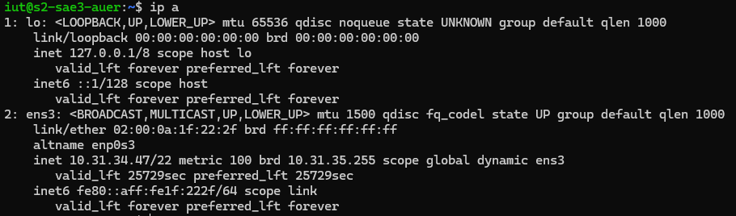

```bash
iut@s2-sae3-auer:~$ nslookup 10.31.34.47
47.34.31.10.in-addr.arpa        name = 2A4V3-31UVM0559.ad-urca.univ-reims.fr.34.31.10.in-addr.arpa.

Authoritative answers can be found from:
34.31.10.in-addr.arpa   nameserver = linf.ad-urca.univ-reims.fr.
linf.ad-urca.univ-reims.fr      internet address = 10.31.6.16
```
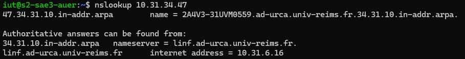

```bash
iut@s2-sae3-auer:~$ sudo apt update
iut@s2-sae3-auer:~$ sudo apt install openssh-server
Lecture des listes de paquets... Fait
Construction de l'arbre des dépendances... Fait
Lecture des informations d'état... Fait
openssh-server est déjà la version la plus récente (1:8.9p1-3ubuntu0.14).
```

Nous avons rencontré un problème car étant connectés à la machine virtuelle à distance via SSH, nous n'avons pas exécuté la commande sudo systemctl stop ssh demandée dans l'énoncé, car cela aurait immédiatement coupé la machine et au moment où nous avons fait la manipulation, le propiétaire de la machine à subit un problème de vpn qui nous enlevait la possiblité de relacer la machine virtuelle à distance, et nous aurait donc stoper dans notre travail. Pour être sûr de ne pas nous bloquer, à cette étapes, j'ai eu recours à l'IA. Nous avons donc directement testé le redémarrage et vérifié le statut du service :

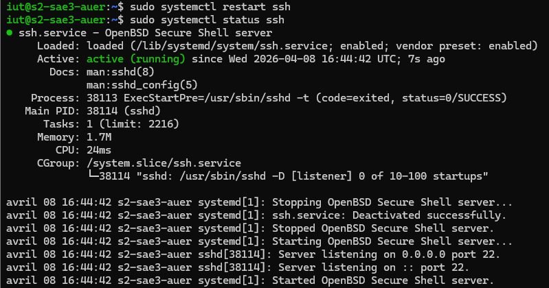

---

### 2. Serveur Web apache2

#### 2.1 Installation de base du serveur

```bash
iut@s2-sae3-auer:~$ sudo a2enmod userdir
Enabling module userdir.
To activate the new configuration, you need to run:
  systemctl restart apache2
iut@s2-sae3-auer:~$ sudo systemctl restart apache2
iut@s2-sae3-auer:~$ sudo mkdir /home/iut/public_html
iut@s2-sae3-auer:~$ sudo setfacl -m u:www-data:rx /home/iut
iut@s2-sae3-auer:~$ sudo setfacl -d -m u:www-data:rx /home/iut/public_html
iut@s2-sae3-auer:~$ sudo nano /etc/apache2/mods-available/userdir.conf
```

Création de la page de test (en utilisant tee pour contourner un problème de droits de redirection, documenté dans la section IA) :

```bash
iut@s2-sae3-auer:~$ echo "Bienvenue sur votre site perso" | sudo tee /home/iut/public_html/bienvenue.html
Bienvenue sur votre site perso
```

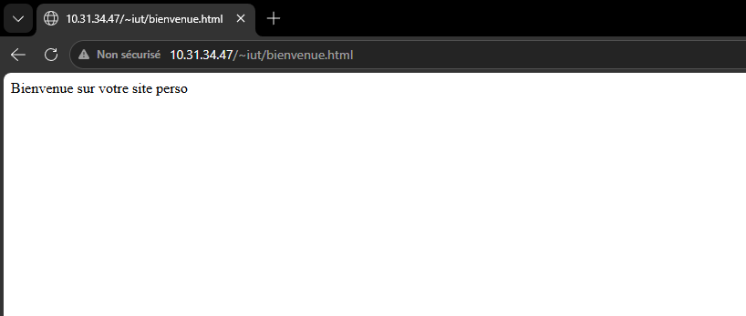

#### 2.2 Installation du serveur Web virtuel


Nous avons ensuite créé un VirtualHost lié à notre nom DNS pour héberger notre second site dans un répertoire de travail spécifique.

```bash
iut@s2-sae3-auer:~$ sudo cp /etc/apache2/sites-available/000-default.conf /etc/apache2/sites-available/2A4V3-31UVM0559.conf
iut@s2-sae3-auer:~$ sudo nano /etc/apache2/sites-available/2A4V3-31UVM0559.conf
```

Création du répertoire lié, configuration des droits et activation du site :

```bash
iut@s2-sae3-auer:~$ sudo mkdir /home/iut/mon-serveur
iut@s2-sae3-auer:~$ sudo setfacl -m u:www-data:rx /home/iut/mon-serveur
iut@s2-sae3-auer:~$ sudo setfacl -d -m u:www-data:rx /home/iut/mon-serveur
iut@s2-sae3-auer:~$ sudo ln -s /home/iut/mon-serveur /var/www
iut@s2-sae3-auer:~$ echo "Bienvenue sur mon serveur virtuel" | sudo tee /home/iut/mon-serveur/index.html
Bienvenue sur mon serveur virtuel
iut@s2-sae3-auer:~$ sudo a2ensite 2A4V3-31UVM0559.conf
Site 2A4V3-31UVM0559 already enabled
iut@s2-sae3-auer:~$ sudo systemctl reload apache2
```
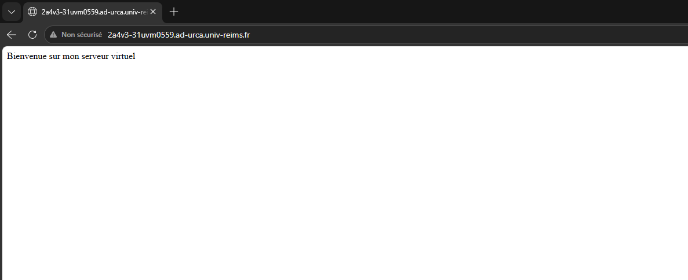

---

### 3. Serveur Web sécurisé https

Afin de sécuriser notre serveur, nous avons d'abord vérifié la présence des paquets liés à SSL et généré un certificat auto-signé.

```bash 
iut@s2-sae3-auer:~$ dpkg -l | grep ssl
ii  libssl3:amd64                          3.0.2-0ubuntu1.21                       amd64        Secure Sockets Layer toolkit - shared libraries
ii  libxmlsec1-openssl:amd64               1.2.33-1build2                          amd64        Openssl engine for the XML security library
ii  libzstd1:amd64                         1.4.8+dfsg-3build1                      amd64        fast lossless compression algorithm
ii  openssl                                3.0.2-0ubuntu1.21                       amd64        Secure Sockets Layer toolkit - cryptographic utility
ii  python3-openssl                        21.0.0-1ubuntu0.1                       all          Python 3 wrapper around the OpenSSL library
ii  ssl-cert                               1.1.2                                   all          simple debconf wrapper for OpenSSL
ii  zstd                                   1.4.8+dfsg-3build1
```
Nous avons tenté d'installer les paquets demandés, mais avons rencontré une erreur sur le nom du paquet libssl.

```bash 
iut@s2-sae3-auer:~$ sudo apt install libssl openssl ssl-cert
[sudo] password for iut:
Lecture des listes de paquets... Fait
Construction de l'arbre des dépendances... Fait
Lecture des informations d'état... Fait
E: Impossible de trouver le paquet libssl
```
Nous avons ensuite créé le répertoire de stockage et généré le certificat auto-signé en y intégrant notre nom DNS et notre adresse IP :

```bash
iut@s2-sae3-auer:~$ sudo mkdir -p /etc/apache2/ssl
iut@s2-sae3-auer:~$ sudo /usr/sbin/make-ssl-cert /usr/share/ssl-cert/ssleay.cnf /etc/apache2/ssl/apache.pem
```

Création et édition du VirtualHost sécurisé à partir du modèle par défaut :

```bash
iut@s2-sae3-auer:~$ sudo cp /etc/apache2/sites-available/default-ssl.conf /etc/apache2/sites-available/mon-serveur-ssl.conf
iut@s2-sae3-auer:~$ sudo nano /etc/apache2/sites-available/mon-serveur-ssl.conf
```
Nous avons activé le module SSL, notre nouveau site sécurisé, et redémarré le service Apache2 :

```bash
iut@s2-sae3-auer:~$ sudo a2enmod ssl
Considering dependency setenvif for ssl:
Module setenvif already enabled
Considering dependency mime for ssl:
Module mime already enabled
Considering dependency socache_shmcb for ssl:
Enabling module socache_shmcb.
Enabling module ssl.
See /usr/share/doc/apache2/README.Debian.gz on how to configure SSL and create self-signed certificates.
To activate the new configuration, you need to run:
  systemctl restart apache2
iut@s2-sae3-auer:~$ sudo a2ensite mon-serveur-ssl.conf
Enabling site mon-serveur-ssl.
To activate the new configuration, you need to run:
  systemctl reload apache2
iut@s2-sae3-auer:~$ sudo systemctl restart apache2
```

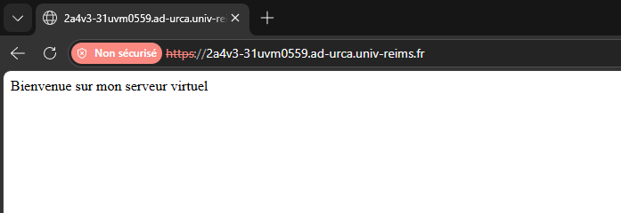

---

### 4. Langage de programmation PHP

Pour que notre serveur soit capable d'exécuter du code dynamique, on a installé PHP et Apache.

```bash
iut@s2-sae3-auer:~$ sudo apt install php libapache2-mod-php
Lecture des listes de paquets... Fait
Construction de l'arbre des dépendances... Fait
Lecture des informations d'état... Fait
Les paquets supplémentaires suivants seront installés :
  libapache2-mod-php8.1 php-common php8.1 php8.1-cli php8.1-common php8.1-opcache php8.1-readline
Paquets suggérés : [...]
```
Nous avons ensuite modifié la configuration de PHP pour autoriser son exécution dans les répertoires utilisateurs public_html.

```bash
iut@s2-sae3-auer:~$ sudo nano /etc/apache2/mods-enabled/php8.1.conf
```

Nous avons redémarré Apache et créé une page de test :

```bash
iut@s2-sae3-auer:~$ sudo systemctl restart apache2
iut@s2-sae3-auer:~$ echo "<?php phpinfo();" | sudo tee /home/iut/public_html/index.php
<?php phpinfo();
```


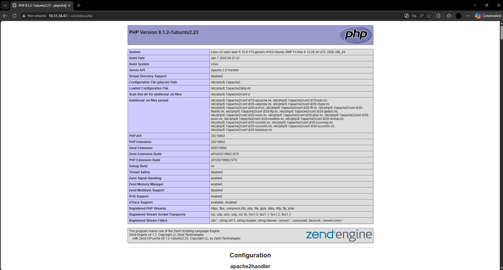

---

### 5. Serveur de base de données MySQL

#### 5.1 Installation et sécurisation initiale

- D'abord, on installe le paquet du serveur :

```bash
iut@s2-sae3-auer:~$ sudo apt update
iut@s2-sae3-auer:~$ sudo apt install mysql-server
```

Ensuite, on lance le script de sécurité pour configurer la base :

```bash
iut@s2-sae3-auer:~$ sudo mysql_secure_installation
```

- Choix effectués lors de la configuration :

On a répondu "Non" à la première question (VALIDATE PASSWORD) pour pouvoir utiliser des mots de passe simples pour le TP. On a mis un mot de passe et on a répondu "Oui" à tout le reste du script.

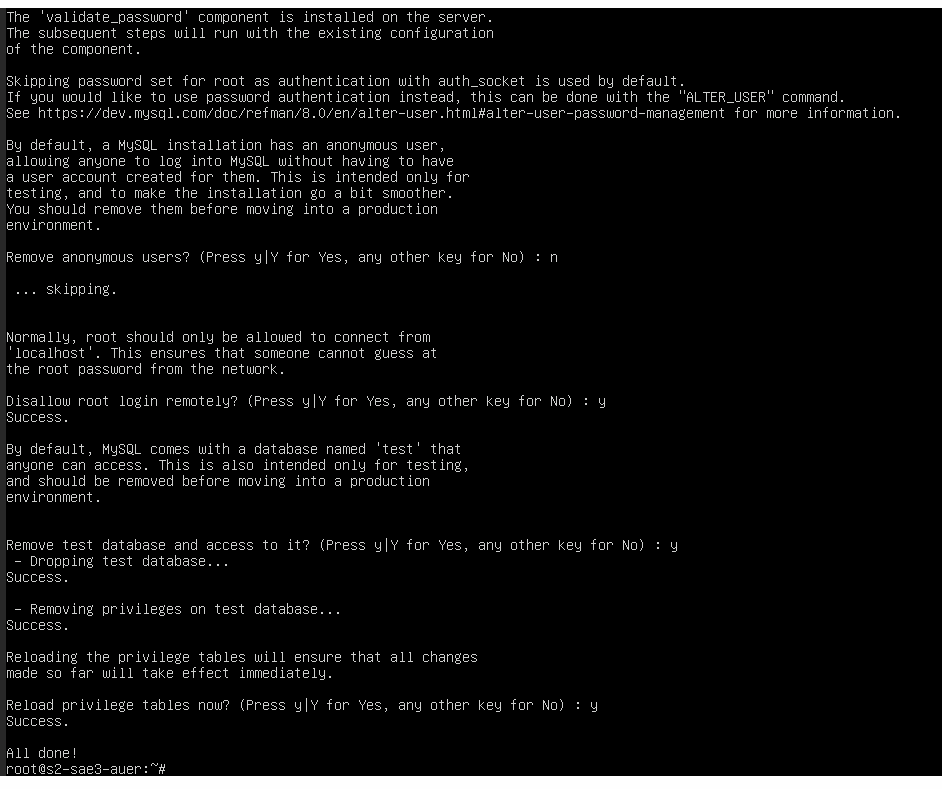

#### 5.2 Création de l'utilisateur administrateur
On crée un utilisateur admin pour gérer les bases sans utiliser le compte root :

```bash
iut@s2-sae3-auer:~$ sudo mysql
```

- Une fois dans l'interface MySQL, nous avons saisi les requêtes suivantes :

```SQL
-- Création de l'utilisateur avec un mot de passe simple
CREATE USER 'admin'@'localhost' IDENTIFIED BY 'simple_mot_de_passe';

-- Attribution de tous les privilèges sur toutes les bases
GRANT ALL PRIVILEGES ON *.* TO 'admin'@'localhost' WITH GRANT OPTION;

-- Application des changements et sortie
FLUSH PRIVILEGES;
exit
```

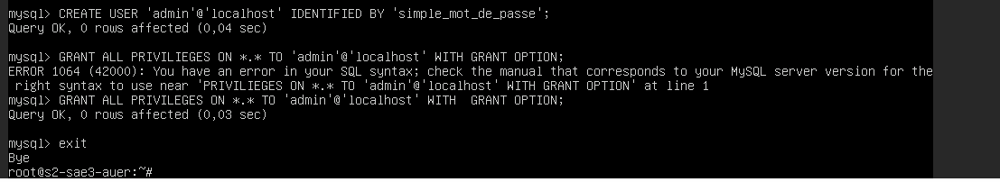

#### 5.3 Redémarrage et test du serveur
On redémarre le service pour que tout soit bien pris en compte :

````bash
iut@s2-sae3-auer:~$ sudo systemctl restart mysql
````

Pour finir, on vérifie que l'utilisateur admin fonctionne avec la commande mysqlshow :

```bash
iut@s2-sae3-auer:~$ mysqlshow -u admin -p
Enter password: simple_mot_de_passe
+--------------------+
|     Databases      |
+--------------------+
| information_schema |
| mysql              |
| performance_schema |
| sys                |
+--------------------+
```

Le serveur nous renvoie bien la liste des bases, donc l'utilisateur est bien configuré.

---

### 6. Outil d'administration de bases de données phpMyAdmin

On a installé phpMyAdmin pour gérer nos bases via une interface web plus simple.

#### 6.1 Installation et configuration

On installe d'abord le paquet :

```bash
iut@s2-sae3-auer:~$ sudo apt install phpmyadmin
Pendant l'installation, on a dû remplir plusieurs menus :
```
Serveur web : On a bien coché apache2 avec la touche Espace.

dbconfig-common : Oui.

Mots de passe : simple_mot_de_passe.

#### 6.2 Activation et premier test

On active ensuite le module PHP nécessaire et on relance Apache :

```Bash
iut@s2-sae3-auer:~$ sudo phpenmod mbstring
iut@s2-sae3-auer:~$ sudo systemctl restart apache2
```
On a testé la connexion sur http://10.31.34.47/phpmyadmin avec l'utilisateur admin créé dans la partie précédente.

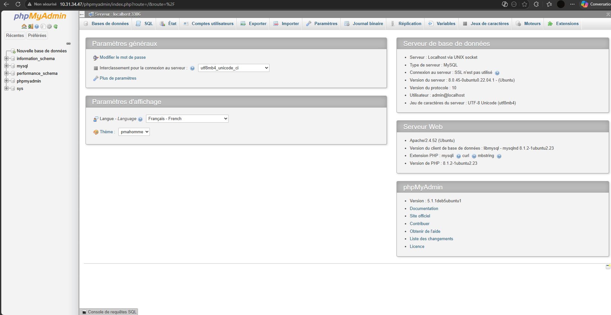

#### 6.3 Création de l'utilisateur mysqltest

Depuis l'onglet "Comptes d'utilisateurs", on a créé un nouvel utilisateur mysqltest. On a bien coché la case "Créer une base de données portant son nom et donner à cet utilisateur tous les privilèges sur cette base".

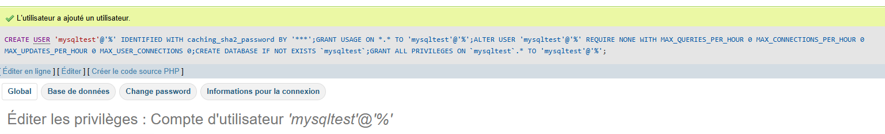

Pour finir, on a vérifié que l'utilisateur mysqltest pouvait se connecter et qu'il voyait bien sa propre base de données.

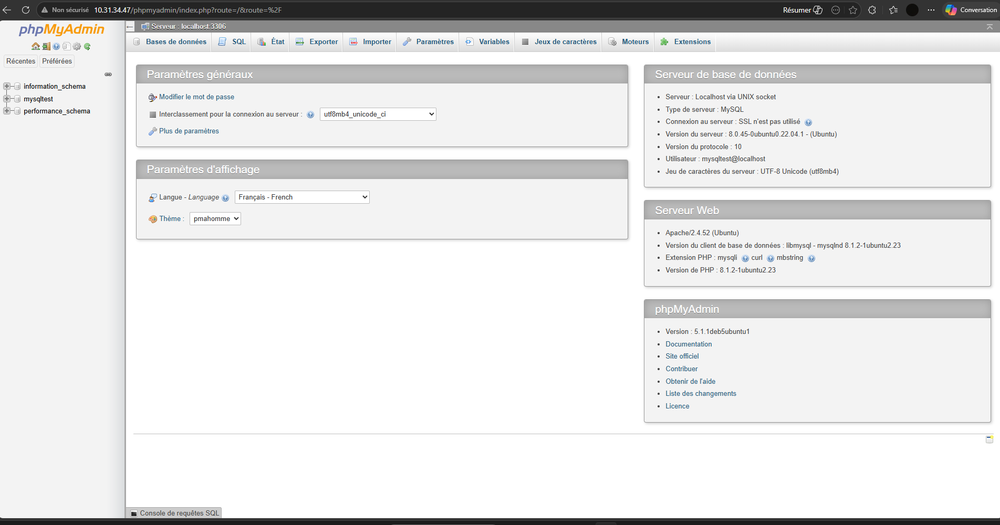

---

### 7. Installation de Samba

#### 7.1 Installation et configuration
On commence par installer le service :

```Bash
iut@s2-sae3-auer:~$ sudo apt update
iut@s2-sae3-auer:~$ sudo apt install samba
``` 

On a ensuite édité le fichier /etc/samba/smb.conf pour ajouter notre partage à la fin :

``` Bash
iut@s2-sae3-auer:~$ sudo nano /etc/samba/smb.conf
``` 

- Configuration ajoutée :

On a configuré le partage pour qu'il soit accessible sans mot de passe (guest) et qu'il force l'utilisation de notre utilisateur iut.

```Ini, TOML
[mon-serveur]
   path = /home/iut/mon-serveur
   browseable = yes
   read only = no
   guest ok = yes
   force user = iut
```
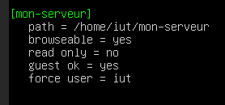

#### 7.2 Lancement et test du partage
On redémarre le service pour appliquer les changements :

````Bash
iut@s2-sae3-auer:~$ sudo systemctl restart smbd
````

- Pour tester, on est allé sur un autre PC Linux du département. Dans le gestionnaire de fichiers, on a tapé l'adresse suivante :

      smb://10.31.34.47/mon-serveur

Le partage s'est ouvert correctement et on a pu voir nos fichiers.

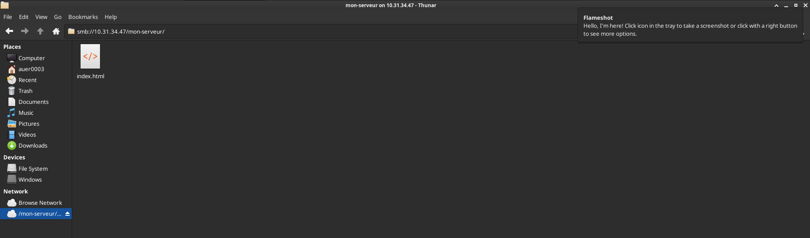

#### 7.3 Arrêt du service

Une fois le test terminé et validé, on a stoppé le serveur conformément aux consignes :

````Bash
iut@s2-sae3-auer:~$ sudo systemctl stop smbd
````

### 8. Plateforme de partage de fichiers Lufi 

#### 8.1 Installation des dépendances et du code

On a commencé par installer les bibliothèques système nécessaires à la compilation des modules Perl et au support de MariaDB :

````Bash
sudo apt install build-essential libssl-dev libio-socket-ssl-perl liblwp-protocol-https-perl zlib1g-dev carton libmariadbd-dev libmariadb-dev-compat
````

Ensuite, on a récupéré le projet sur Framagit :

````Bash
cd /var/www/html
sudo git clone https://framagit.org/fiat-tux/hat-softwares/lufi.git
cd lufi
````

#### 8.2 Configuration des modules (Carton)

L'installation des modules s'est faite via carton. On a suivi la consigne en excluant les bases de données non utilisées :

````Bash
sudo carton install --deployment --without=test --without=sqlite --without=postgresql --without=ldap --without=htpasswd --without=swift-storage
````

- Problème rencontré : Au premier lancement, une erreur indiquait que Mojo::SQLite était manquant. Bien qu'on utilise MySQL, Lufi semble en avoir besoin pour charger ses plugins de base.

      Correction : On a forcé l'installation du module avec sudo carton install Mojo::SQLite.

#### 8.3 Base de données et lufi.conf

Côté MySQL, on a créé la base et l'utilisateur dédié :

```SQL
CREATE DATABASE lufi;
CREATE USER 'lufi'@'localhost' IDENTIFIED BY 'lufiutinfo';
GRANT ALL PRIVILEGES ON lufi.* TO 'lufi'@'localhost';
On a ensuite paramétré le fichier lufi.conf :
```

Réseau : Port 8081 sur l'IP de la VM.

Obligatoire : Renseignement d'un mail de contact et d'une phrase secrète (secrets).

Base de données : Activation du bloc mysqldb avec nos identifiants MySQL.

#### 8.4 Lancement

Démarrage du serveur avec hypnotoad :

````Bash
sudo carton exec hypnotoad script/lufi
````

Le service est bien accessible sur http://10.31.34.47:8081.

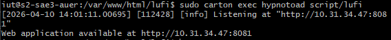

---

## II - Webographie et recours à l'IA

Notez ici les éléments qui vous ont aidé à la réalisation de la SAÉ :

### IA utilisée

```
Intelligences artificielles utilisé : GOOGLE GEMINI 
```

### Prompts utilisés et réponses reçues

- PARTIE I
```
PROMPT :
Est-il possible de relancer une machine virtuelle après cette commande "sudo systemctl stop ssh" ? Je n'ai pas d'accès direct à ma machine virtuelle.

RéPONSE :
Relancer le service SSH via le terminal : C'est impossible.
Si tu as tapé sudo systemctl stop ssh en étant connecté uniquement via SSH, ta connexion a été coupée instantanément. C'est comme si tu avais fermé une porte blindée de l'extérieur en laissant les clés à l'intérieur. Tu ne peux plus taper la commande start pour le rallumer.
```

- PARTIE II - Serveur Web Apache

```
PROMPT :
J'ai tapé la commande `sudo echo "Bienvenue sur votre site perso" > /home/iut/public_html/bienvenue.html` mais j'obtiens l'erreur "Permission denied" alors que j'utilise sudo. Pourquoi ?

RÉPONSE :
C'est un classique sous Linux ! Quand tu tapes cette commande, le terminal prépare d'abord la redirection `>` avec tes droits d'utilisateur normaux *avant* de lancer la commande `sudo echo`. Comme tu n'as pas les droits d'écriture dans ce dossier, le terminal bloque.
Pour contourner cela, utilise l'outil `tee` qui prend ce qu'on lui envoie et l'écrit dans un fichier, et qui peut être lancé avec sudo :
echo "Bienvenue sur votre site perso" | sudo tee /home/iut/public_html/bienvenue.html
```

- PARTIE III :

```
PROMPT :
J'ai configuré mon serveur Apache avec un certificat auto-signé pour utiliser le HTTPS. Pourtant, quand je vais sur mon site `https://2a4v3-31uvm0559.ad-urca.univ-reims.fr`, mon navigateur m'affiche un gros avertissement rouge disant que "la connexion n'est pas sécurisée". 

RÉPONSE :
Non, tu n'as raté aucune étape ! C'est le comportement tout à fait normal lorsque l'on utilise un certificat "auto-signé".
Les navigateurs web (Chrome, Firefox, etc.) font confiance à une liste pré-établie d'Autorités de Certification reconnues (comme Let's Encrypt ou DigiCert). Comme c'est toi-même qui as généré ce certificat localement (via `make-ssl-cert`), le navigateur ne le reconnaît pas comme une source de confiance et lève une alerte. 
Rassure-toi : le trafic entre le navigateur et ton serveur est bel et bien chiffré ! C'est juste l'identité du serveur qui n'est pas validée par un tiers. Pour afficher ta page, il suffit de cliquer sur "Paramètres avancés" puis "Accepter le risque et continuer".
```

- PARTIE IV :

``` 
PROMPT :
J'ai créé mon fichier `index.php` avec la fonction `<?php phpinfo(); ?>` à l'intérieur dans mon dossier public_html. Mais quand je charge la page dans mon navigateur, je vois juste le texte brut de mon code au lieu de voir le grand tableau d'informations PHP.

RÉPONSE :
C'est une protection de sécurité par défaut d'Apache ! Pour éviter qu'un utilisateur n'exécute des scripts malveillants, le module PHP est configuré pour être désactivé dans les répertoires personnels (ceux gérés par le module `userdir` comme ton `public_html`). 
Pour l'autoriser, tu dois modifier le fichier de configuration du module PHP (par exemple `/etc/apache2/mods-enabled/php8.1.conf`). À l'intérieur, cherche le bloc `<Directory /home/*/public_html>` et commente (en ajoutant un `#`) la ligne `php_admin_flag engine Off` ainsi que les lignes qui l'entourent. N'oublie pas de redémarrer ton service Apache (`sudo systemctl restart apache2`) pour appliquer la modification !
```

- PARTIE V : MySQL :

```
PROMPT : J'essaie de me connecter à MySQL avec mon nouvel utilisateur admin depuis un script PHP, mais j'ai une erreur "Access denied". Pourtant, j'ai bien créé l'utilisateur avec un mot de passe.

RÉPONSE : Par défaut, MySQL utilise parfois le plugin auth_socket pour les utilisateurs locaux, ce qui force à utiliser sudo. Pour une connexion via un script (comme PHP ou phpMyAdmin), il faut s'assurer que l'utilisateur utilise l'authentification par mot de passe standard. La commande SQL est : ALTER USER 'admin'@'localhost' IDENTIFIED WITH mysql_native_password BY 'votre_mdp';. N'oublie pas le FLUSH PRIVILEGES; pour que MySQL recharge la table des droits immédiatement.
```

PARTIE VI : phpMyAdmin

```
PROMPT : J'ai installé le paquet phpmyadmin avec apt, mais quand je vais sur http://<IP>/phpmyadmin, j'ai une erreur 404. Apache ne semble pas trouver le dossier.

RÉPONSE : C'est un oubli classique lors de l'installation ! Si tu n'as pas coché "apache2" avec la barre d'espace lors de l'assistant de configuration, le lien entre Apache et phpMyAdmin n'est pas créé. Tu peux le corriger sans tout réinstaller en ajoutant une ligne à la fin de ton fichier /etc/apache2/apache2.conf : Include /etc/phpmyadmin/apache.conf. Relance ensuite Apache (sudo systemctl restart apache2) et l'alias sera actif.
```

- PARTIE VII : Samba : 

```
PROMPT : J'ai configuré mon partage Samba dans smb.conf, mais quand j'essaie d'écrire dedans depuis un autre PC, j'ai une erreur "Permission denied", même si j'ai mis read only = no.

RÉPONSE : Samba est soumis à deux couches de droits : les droits du partage (Samba) et les droits du système de fichiers (Linux). Si ton dossier /home/iut/mon-serveur appartient à l'utilisateur iut avec des droits restreints, un invité Samba ne pourra pas écrire dedans. Une solution propre est d'ajouter la ligne force user = iut dans ta configuration de partage dans /etc/samba/smb.conf. Ainsi, toute action réseau sera exécutée avec les permissions de ton utilisateur local iut.
```

- PARTIE VIII : Lufi :

```
PROMPT : L'installation de Lufi avec carton échoue avec l'erreur Can't locate Mojo/SQLite.pm, pourtant j'ai bien suivi la consigne en mettant l'option --without=sqlite.

RÉPONSE : C'est un piège de la version actuelle de Lufi. Même si tu configures MySQL pour le stockage final, l'application charge certains composants (les Helpers) qui dépendent du module Mojo::SQLite au démarrage. L'option --without=sqlite empêche son installation, ce qui bloque le boot. La solution est de passer outre la consigne et d'installer manuellement le module avec sudo carton install Mojo::SQLite. L'application pourra alors démarrer et utiliser ta base MySQL comme prévu.
```

- Pour toutes les parties :

```
PROMPT : Embelli l'écriture/syntaxe et corrige les fautes d'écriture du compte-rendu.
```


### Webographie et se qu'on a retenu

#### 1. Gestion des services

Systemd : Appris à manipuler les états des services (start, stop, restart).

La désactivation de sshd coupe immédiatement l'accès distant, confirmant le rôle crucial du PID 1.

#### 2. Serveur Web Apache

Virtual Hosts : Appris à gérer plusieurs sites sur une seule IP via les fichiers .conf.

L'utilisation de liens symboliques permet d'activer ou désactiver un site proprement sans supprimer de fichiers.

#### 3. Serveur sécurisé HTTPS

Certificats SSL : Appris à générer un certificat auto-signé avec openssl.

Le navigateur affiche une alerte de sécurité car le certificat n'est pas signé par une autorité officielle, mais les données sont chiffrées.

#### 4. Langage PHP

Moteur PHP : Appris que l'exécution des scripts est bridée par défaut dans les dossiers userdir.

Il est nécessaire de modifier la configuration globale du module PHP pour autoriser l'interprétation du code.

#### 5. Serveur MySQL

Privilèges SQL : Appris à sécuriser l'instance avec mysql_secure_installation.

La création d'un utilisateur admin avec des droits complets est indispensable pour la gestion courante sans utiliser le compte root.

#### 6. phpMyAdmin

Administration Web : Appris à lier l'outil au serveur Apache via un fichier de configuration dédié.

L'interface permet de gérer graphiquement les permissions complexes et de créer des bases par utilisateur.

#### 7. Samba

Partage réseau : Appris à configurer le protocole SMB pour rendre un dossier Linux accessible sous Windows/macOS.

Il faut bien synchroniser les droits UNIX du dossier avec les permissions déclarées dans smb.conf.

#### 8. Lufi

Dépendances Perl : Appris à utiliser carton pour isoler les bibliothèques d'une application complexe.

Malgré l'usage de MySQL, le module Mojo::SQLite reste indispensable au chargement initial du logiciel.

---

